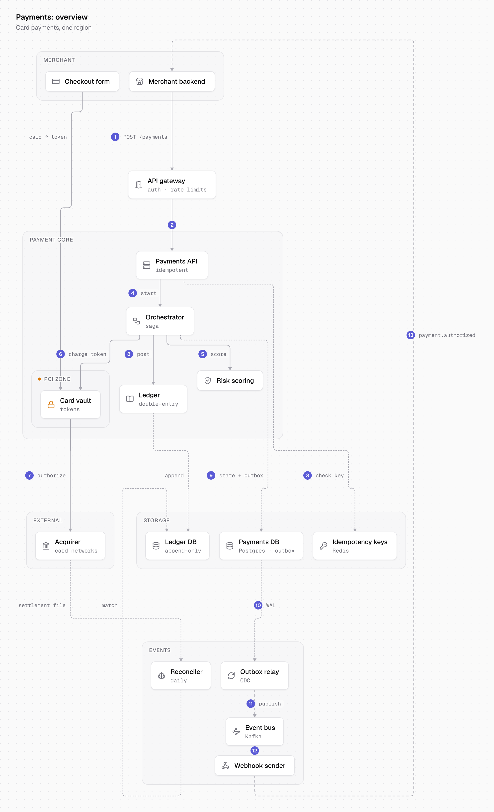

# diagram kit

a skill that lets claude code and codex draw diagrams people actually understand.

you ask. the agent works out what is true, writes it down, asks when something is unclear, and then draws. a layout engine does the positioning, so the picture is clean every time: parts in reading order, wires at right angles, nothing on top of anything else.

the result is one html page you can pan, zoom, hover, click and play.



## what it draws

- system design and architecture
- flowcharts and processes
- sequence diagrams
- state machines
- data models
- trees and mind maps

## how it works

- **brief**: for anything non-trivial the agent writes a short document first: the question, the parts, the flows, and every fact with its source. you approve it. if you already have a document, it reads that instead.
- **spec**: a small yaml file with meaning only. tiers, groups, flows. no coordinates.
- **layout**: [elk](https://eclipse.dev/elk/) places everything. sequences, trees and mind maps have their own layouts.
- **check**: overlaps, wires through parts, crossings, backwards flow, crowding, unsourced facts. measured, not guessed.
- **page**: a self-contained html page in a quiet vercel/linear-ish style. light and dark. or a react component, or a png.

## install

claude code:

```
/plugin marketplace add Alireza29675/diagram-kit
/plugin install diagram-kit@diagram-kit
```

codex:

```
codex plugin marketplace add Alireza29675/diagram-kit
codex plugin add diagram-kit@diagram-kit
```

or copy `plugins/diagram-kit/skills/create-diagram` into `.claude/skills/` or `.agents/skills/`.

then once per install (node 22.12+; codex will ask to run it outside the sandbox):

```
npm ci --ignore-scripts --prefix <path-to>/skills/create-diagram/scripts
```

## use it

just ask, or call the skill by name (`/diagram-kit:create-diagram` in claude code, `$diagram-kit:create-diagram` in codex):

- "diagram how a request flows through this repo"
- "turn docs/architecture.md into diagrams"
- "draw the checkout state machine"
- "quick sequence of the login flow, nothing fancy"

or drive the scripts yourself:

```
node skills/create-diagram/scripts/diagram.mjs example architecture > shop.yaml
node skills/create-diagram/scripts/diagram.mjs build shop.yaml
open shop.html
```

## tune it

- every colour, font and size is a token. override them in the spec, with `--tokens`, or with css variables (`--dk-accent`, ...).
- `layout.json` holds every final position, so you can render it any way you like.
- the viewer is one small readable module. change it.

## example

`examples/payments/` is a card payments platform: a brief with checked facts, an overview, and the authorization saga as a sequence. open the html files.

## license

mit. bundles geist (ofl) and lucide icons (isc); see [NOTICE.md](NOTICE.md).
