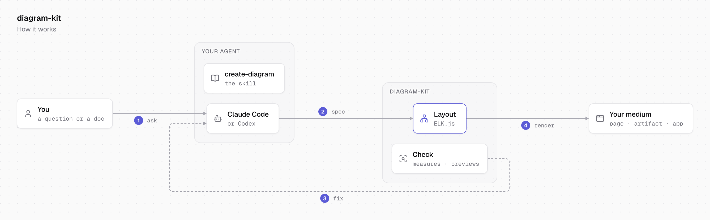

# diagram-kit

Agents are bad at placing boxes!:D diagram-kit gives Claude Code and Codex a layout engine ([ELK.js](https://eclipse.dev/elk/)) and a skill, `create-diagram`, with the instructions and intuition to draw clear, well-positioned diagrams in whatever medium you work in.

<a href="https://alireza29675.github.io/diagram-kit/"><picture>
  <source media="(prefers-color-scheme: dark)" srcset="docs/index.dark.png">
  
</picture></a>

## install

claude code

```
/plugin marketplace add Alireza29675/diagram-kit
/plugin install diagram-kit@diagram-kit
```

codex

```
codex plugin marketplace add Alireza29675/diagram-kit
codex plugin add diagram-kit@diagram-kit
```

then ask your agent for a diagram.

mit · [notice](NOTICE.md)
